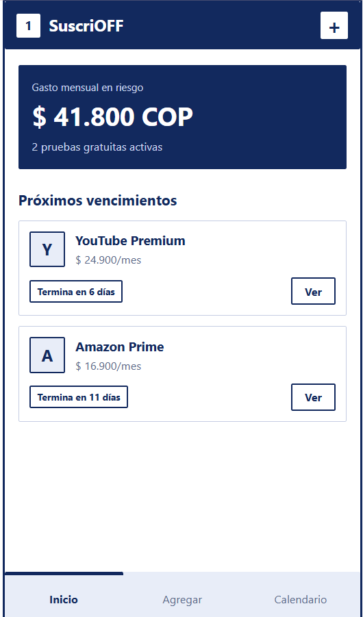

# SuscriOFF

Avisa cuándo termina la prueba gratuita de una suscripción (Spotify Premium, YouTube Premium, etc.) para evitar cobros por olvido, con el enlace de cancelación a mano.



## Estado actual

Aplicación completa de cuatro pantallas: inicio con gasto en riesgo y próximos vencimientos, alta de pruebas mediante escaneo de texto con regex y campos editables, detalle con cuenta regresiva e interruptor de aviso, y confirmación del recordatorio con enlace de plantilla a Google Calendar. Todo se guarda en `localStorage` y se usa una paleta monocromática azul marino.

## Cómo ejecutarlo

Abre `index.html` en el navegador o levanta un servidor local con `python3 -m http.server 8000` y entra en `http://localhost:8000`. No hay dependencias ni build.

```bash
git clone https://github.com/carenhr1/suscrioff-mvp.git
cd suscrioff-mvp
python3 -m http.server 8000
```

Después abre `http://localhost:8000` en el navegador.

### Mini guía de prueba

1. Pulsa el botón **+** para agregar una prueba nueva.
2. Pega el texto `Tu prueba de YouTube Premium termina el 27/11/2026. Luego pagarás $24.900 al mes. Cancela en youtube.example/cancelar`.
3. Pulsa **Escanear texto o enlace** para extraer la fecha, el importe y el enlace de cancelación; revisa los campos editables si hace falta.
4. Pulsa **Guardar** para registrar la prueba.
5. En el detalle, activa el aviso (interruptor «Avisarme 2 días antes»), pulsa **Guardar aviso** y abre el recordatorio con **Abrir en Google Calendar**.

## Archivos

- `index.html` — estructura de la interfaz.
- `styles.css` — estilos: azul marino `#12295E` y esquinas cuadradas (radio máx. 2px).
- `app.js` — modelo, navegación, localStorage, cálculos y carga única de datos de ejemplo.
- [`docs/README-detallado.md`](docs/README-detallado.md) — alcance y decisiones del MVP.

## Reglas del MVP

- HTML, CSS y JavaScript puros; sin frameworks ni build.
- Datos guardados en `localStorage`; solo datos ficticios (Ley 1581 de 2012).
- Sin pagos y sin cancelación automática.
- Esquinas rectas y color principal `#12295E`.

## Tecnologías usadas

- HTML, CSS y JavaScript puros.
- `localStorage` para guardar las pruebas y los avisos.
- Enlace de plantilla de Google Calendar para los recordatorios.
- Git y GitHub (GitHub, s.f.).
- Ubuntu sobre WSL (Microsoft, s.f.).
- OpenCode (OpenCode, s.f.).
- Fizzy (37signals, s.f.).

## Referencias

37signals. (s.f.). Fizzy: A modern spin on kanban for tracking anything. https://www.fizzy.do

GitHub. (s.f.). Quickstart for repositories. GitHub Docs. https://docs.github.com/en/repositories/creating-and-managing-repositories/quickstart-for-repositories

Ley 1581 de 2012. Por la cual se dictan disposiciones generales para la protección de datos personales. 17 de octubre de 2012. D.O. No. 48.587. https://www.funcionpublica.gov.co/eva/gestornormativo/norma.php?i=49981

Microsoft. (s.f.). How to install Linux on Windows with WSL. Microsoft Learn. https://learn.microsoft.com/en-us/windows/wsl/install

OpenCode. (s.f.). OpenCode: The open source AI coding agent. https://opencode.ai
